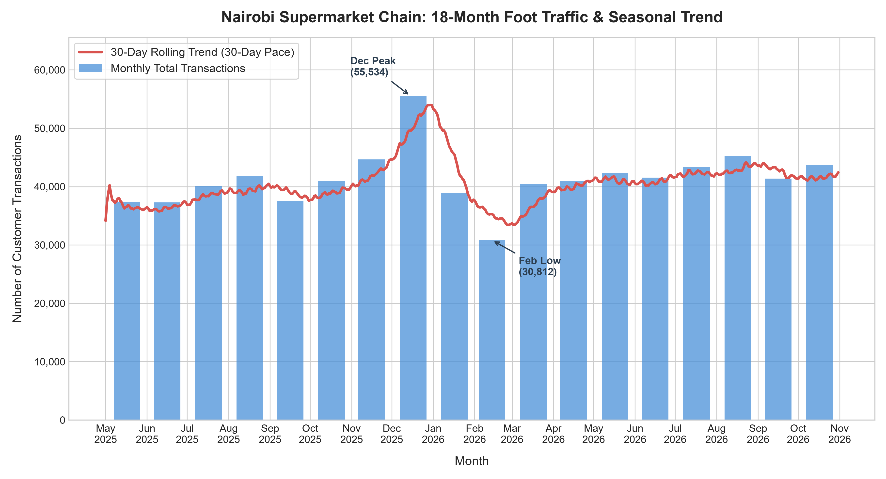

# Nairobi Supermarket Foot Traffic & Seasonality Analysis

## Client Trend Report
Customer foot traffic shows a clear, recurring seasonal cycle, peaking sharply during the December holiday rush and dropping to its lowest point in February after the festive season. Beyond these predictable seasonal swings, the 30-day rolling average confirms a steady upward baseline in customer visits over the 18-month period, showing genuine business growth rather than random fluctuation.

## Visualization

## How to Run
1. Install the required libraries:
   bash
   pip install numpy pandas matplotlib
   
2. Run the script to generate the data and export the chart:
   bash
   python supermarket_traffic.py